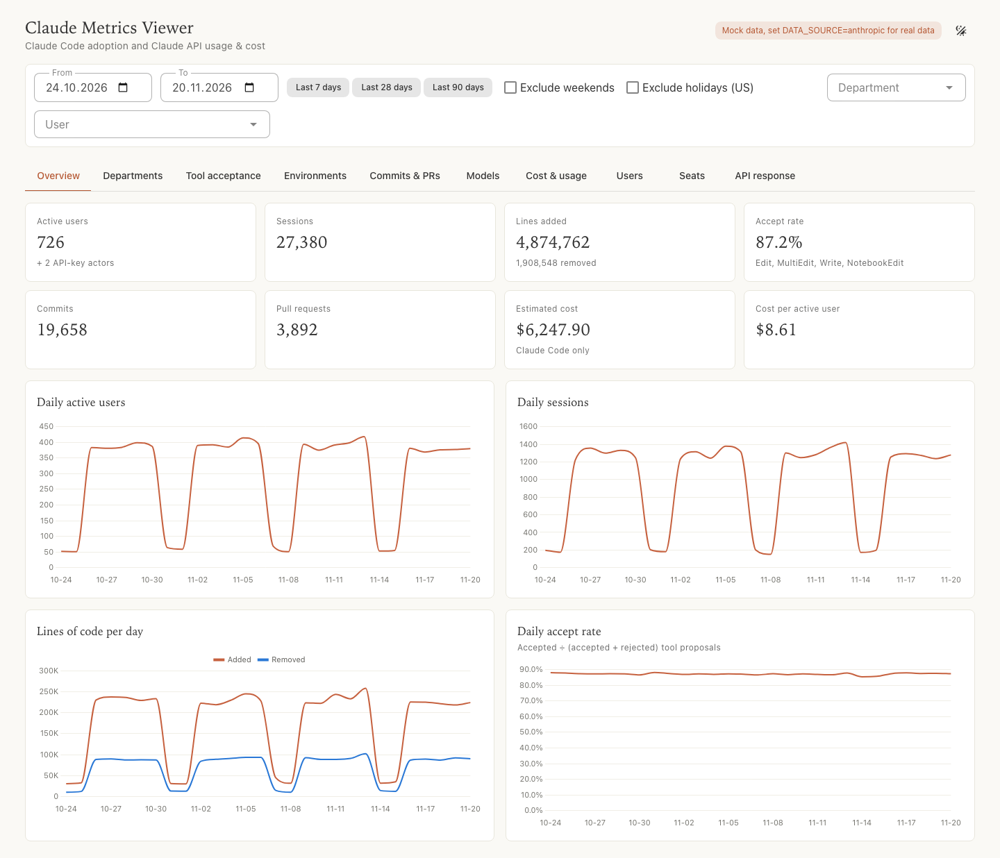
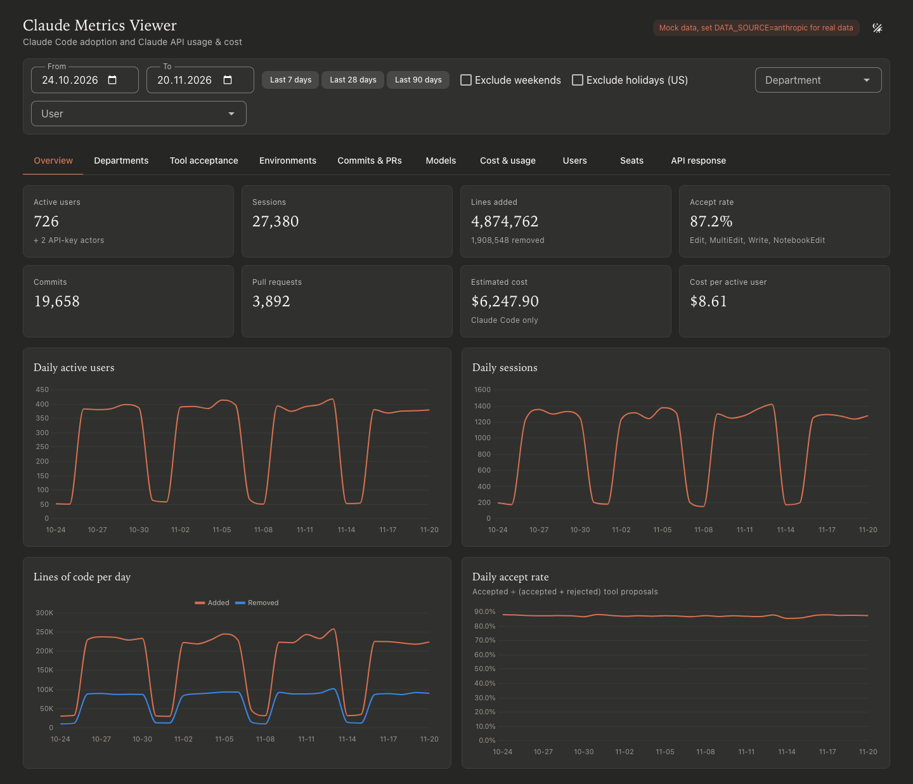
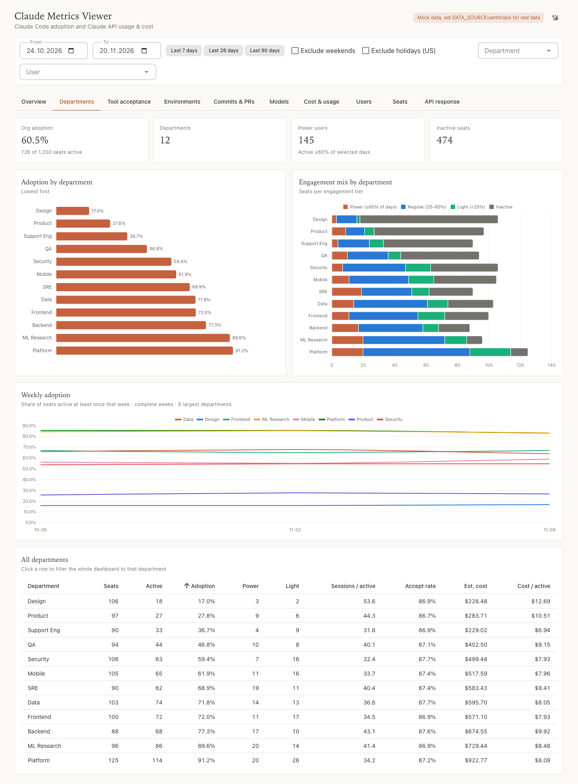
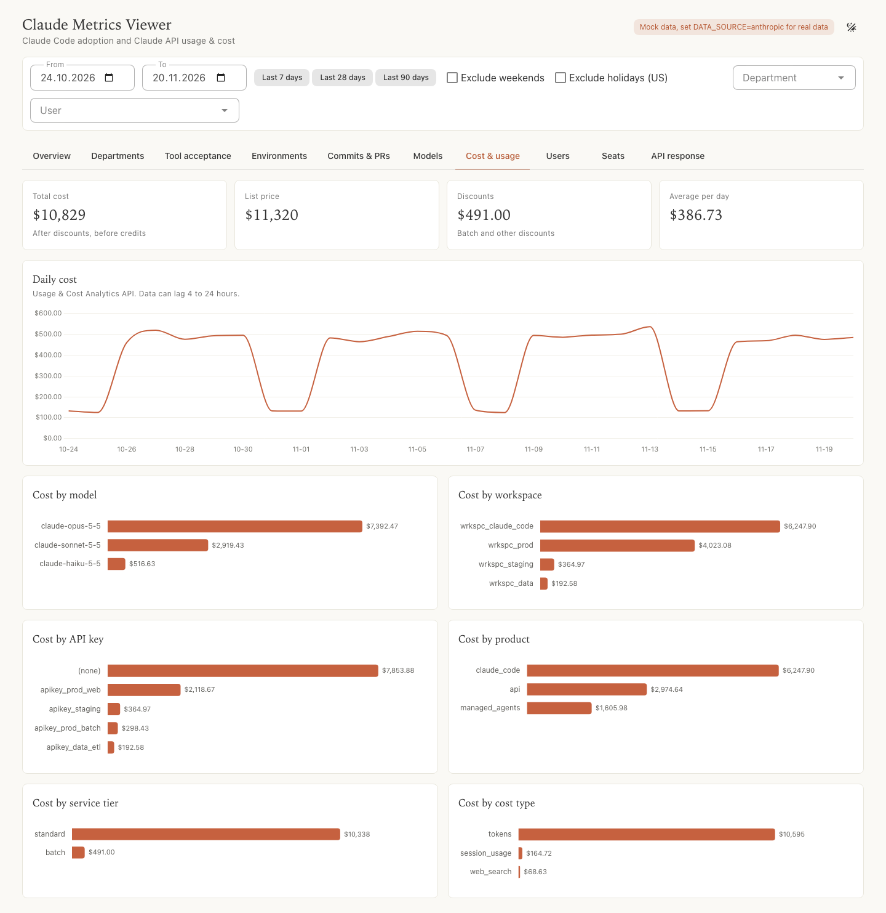
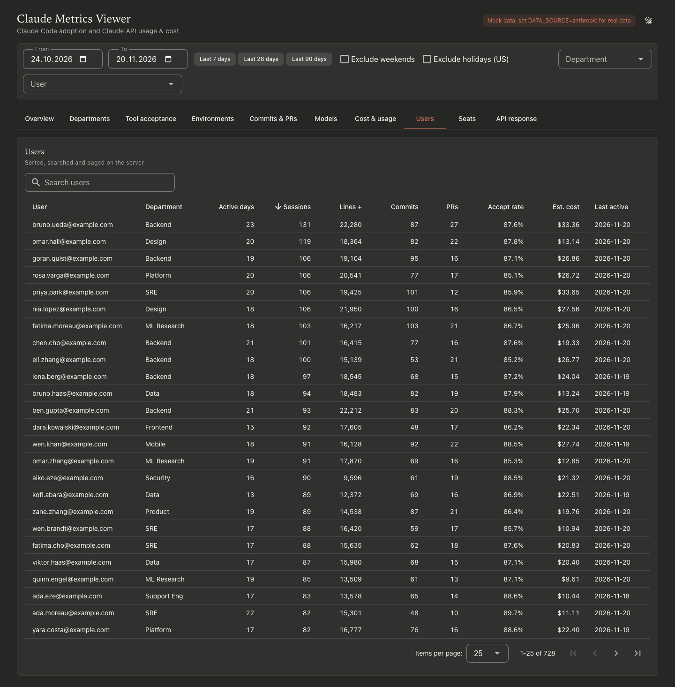
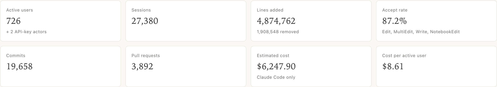
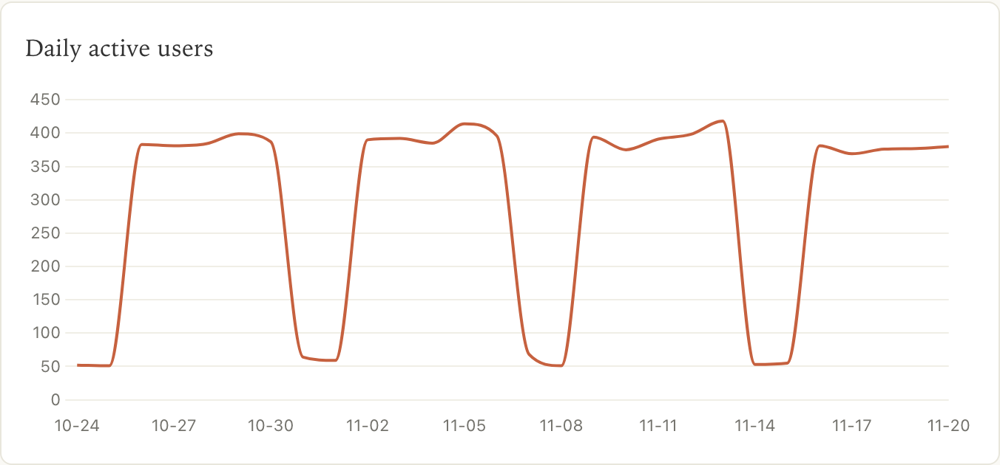
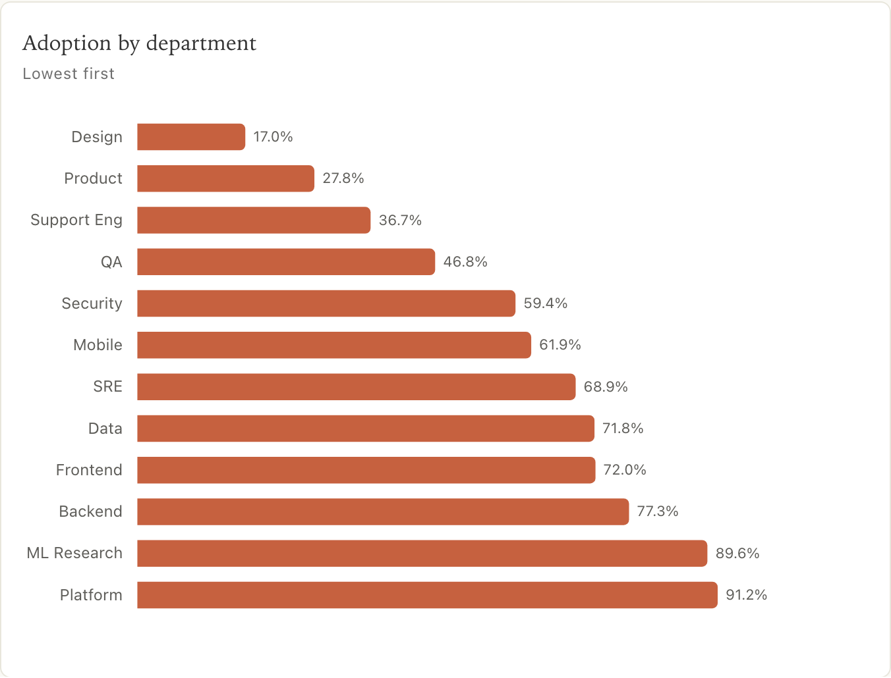
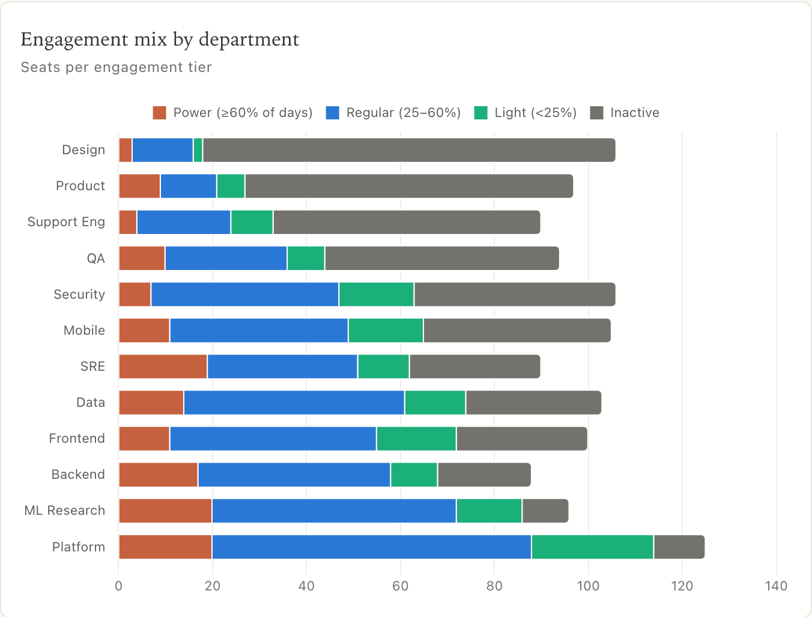
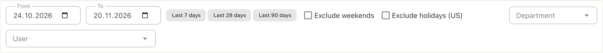

# Claude Metrics Viewer

A dashboard for your Anthropic organization's **Claude Code adoption** and **Claude API usage & cost**, in the spirit of GitHub's Copilot Metrics Viewer.

It runs on deterministic mock data out of the box. Point it at a real organization by setting two environment variables.

Built with the same stack as the Copilot Metrics Viewer: **Nuxt 4** (Vue 3), **Vuetify 3**, **Chart.js** via `vue-chartjs`, and `date-holidays`.

## Screenshots

All screenshots use the built-in mock data (a 1,200-person org).

| Light | Dark |
|---|---|
|  |  |

The header button switches between system, light and dark themes.

<details>
<summary><strong>Departments</strong>: adoption, engagement mix, weekly trend and a drill-down table</summary>


</details>

<details>
<summary><strong>Cost &amp; usage</strong>: org-wide cost by model, workspace, API key, product, tier and type</summary>


</details>

<details>
<summary><strong>Users</strong>: per-user table, sorted, searched and paged on the server</summary>


</details>

### Widgets

| | |
|---|---|
| **KPI tiles**<br> | **Trend chart**<br> |
| **Ranked bar chart**<br> | **Stacked bar chart**<br> |

**Filter bar** (date range, presets, weekends and holidays, department, user):



## Tabs

| Tab | What it shows | Source |
|---|---|---|
| Overview | Active users, sessions, lines added/removed, accept rate, commits, PRs, estimated cost, daily trends | Claude Code Analytics |
| Departments | Adoption % per department (lowest first), engagement mix (power / regular / light / inactive), weekly adoption trend, cost per active user. Click a row to filter the whole dashboard | Claude Code Analytics + members + department mapping |
| Tool acceptance | Accept rate and volume for Edit, MultiEdit, Write, NotebookEdit | Claude Code Analytics |
| Environments | Sessions and users by terminal; local vs remote | Claude Code Analytics |
| Commits & PRs | Daily commits and PRs by Claude Code, top contributors | Claude Code Analytics |
| Models | Tokens and estimated cost per model | Claude Code Analytics |
| Cost & usage | Org-wide cost by model, workspace, API key, product, service tier, cost type | Usage & Cost Analytics (beta) |
| Users | Per-user table with department, sorted, searched and paged on the server | Claude Code Analytics |
| Seats | Members with no Claude Code activity in the range, searchable and paged | Admin API: members |
| API response | Raw upstream rows for one day | Both |

Filters: date range, 7/28/90-day presets, exclude weekends, exclude holidays (public and bank holidays for `HOLIDAY_COUNTRY`, default `US`; accepts states like `US-CA`), department, and user. Filters live in the URL, so views can be shared. The department and user filters apply to every Claude Code tab; the Cost tab stays organization-wide because the cost API has no department dimension.

### Built for large organizations

- The user filter is a typeahead: the server returns at most 20 matches per keystroke, so the browser never loads the full member list.
- The Users and Seats tables are sorted, searched and paged on the server (25 rows per page).
- Org members are cached for 10 minutes; completed days of Claude Code data are cached in memory.
- The mock org has 1,200 members across 12 departments, so you can see how this behaves at scale.

### Departments

The Console Admin API has no team concept, so departments come from a CSV you export from your HR system or IdP:

```csv
email,department
ada@example.com,Platform
ben@example.com,Data
```

Set `DEPARTMENTS_FILE=/path/to/departments.csv`. Members missing from the file, and active users missing from the member list, show up as **Unassigned**.

Engagement tiers are relative to the selected days: **power** = active on at least 60% of them, **regular** = 25–60%, **light** = under 25%, **inactive** = a seat with no activity. The weekly trend shows complete weeks only, so a partial first or last week doesn't look like a dip.

Claude Enterprise organizations have teams built in (RBAC groups), and their Enterprise Analytics API reports DAU/WAU/MAU, seat counts and activity across chat, Claude Code, Cowork and more. That would be a third data source; it isn't wired in yet.

## Run it

```bash
npm install
npm run dev          # http://localhost:3000, mock data
```

### Real data

```bash
DATA_SOURCE=anthropic ANTHROPIC_ADMIN_KEY=sk-ant-admin... DEPARTMENTS_FILE=./departments.csv npm run dev
```

- The key must be an **Admin API key** from a Claude Console organization (Console → Settings → Admin keys). Workspace API keys are rejected.
- The key is only read on the server. The browser talks to this app's `/api/*` routes, never to Anthropic directly.

Things to know about the upstream data:

- **Claude Code Analytics** (`/v1/organizations/usage_report/claude_code`) covers Claude Code usage authenticated against your Console organization. Usage under Pro/Max/Team/Enterprise subscriptions isn't included; that's in the Claude Enterprise Analytics API or the claude.ai analytics page. It returns one day per request, so a 90-day view makes 90+ calls. Past days are cached in memory.
- **Usage & Cost Analytics** (`/v1/organizations/analytics/cost`) starts at 2026-01-01, looks back at most 365 days, and lags 4–24 hours. Requests are split into 31-day chunks automatically.
- "Estimated cost" on the Claude Code tabs is Anthropic's per-model estimate. "Cost & usage" shows billed amounts after discounts, before credits.

## Test

```bash
npm test             # unit tests (Vitest): aggregation, dates, holidays, query parsing, mock + real source
npm run test:e2e     # Playwright on mock data; reuses a dev server on :3000 if one is running (first time: npx playwright install chromium)
npm run lint         # @nuxt/eslint
npm run typecheck    # vue-tsc
```

## Docker

```bash
docker build -t claude-metrics-viewer .
docker run -p 3000:3000 -e DATA_SOURCE=anthropic -e ANTHROPIC_ADMIN_KEY=sk-ant-admin... claude-metrics-viewer
```

Without Docker: `npm run build && node .output/server/index.mjs`.

## Layout

```
lib/                framework-free data layer (imported as #lib), shared by server routes and unit tests
  sources/          MetricsSource interface; mock.ts (seeded 1,200-person org) and anthropic.ts (Admin API)
  aggregate.ts      raw records → dashboard view models
  departments*.ts   department CSV parsing and per-department rollups
  users.ts          user typeahead and server-side paging
  holidays.ts       date-holidays wrapper
  service.ts        loads data for a query and aggregates it
server/api/         Nitro routes: claude-code, departments, users, user-search, seats, cost, meta, raw
app/
  pages/index.vue   tabs + filter bar; filters live in the URL
  components/tabs/  one component per tab
  components/       KpiTile, DataGrid (v-data-table), UserPicker (v-autocomplete), charts/ (Chart.js)
  utils/palette.ts  validated light/dark chart palette shared by Chart.js and the Vuetify theme
vuetify.config.ts   light/dark themes (system by default, switchable in the header) and component defaults
```

The app renders in the browser (`ssr: false`): it's an internal dashboard, so server rendering would add nothing and would risk date mismatches between server and browser.

There is no auth on the dashboard itself. Put it behind your SSO or ingress auth before exposing it, since it shows per-user activity and cost.
