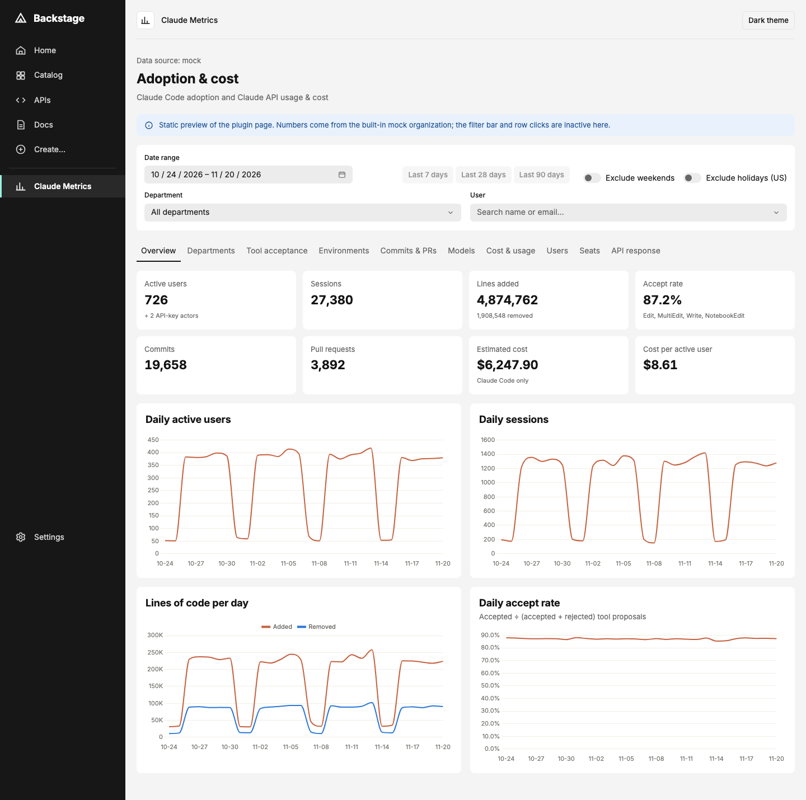

# Claude Metrics for Backstage

The Claude Metrics dashboard as a Backstage plugin: a **Claude Metrics** page in the sidebar with the same ten tabs, filters and numbers as the standalone app.



| Package | What it does |
|---|---|
| `plugins/claude-metrics` (`@internal/backstage-plugin-claude-metrics`) | Frontend plugin, built on Backstage's new frontend system and Backstage UI. Page at `/claude-metrics`, with a sidebar entry. |
| `plugins/claude-metrics-backend` (`@internal/backstage-plugin-claude-metrics-backend`) | Backend plugin. Serves `/api/claude-metrics/*`, the same routes and JSON as the Nuxt app's `server/api`. |
| `plugins/claude-metrics-common` (`@internal/backstage-plugin-claude-metrics-common`) | The `claude-metrics.dashboard.read` permission. The backend checks it on every route and the page checks it before loading; your permission policy decides who has it (for example, managers only). |
| `packages/claude-metrics-lib` (`@internal/claude-metrics-lib`) | The data layer (Anthropic and mock sources, aggregation, departments, holidays, palette, formatters). The Nuxt app imports it as `#lib`; the plugins depend on it. `.` is browser-safe, `./server` is the Node entry. |
| `preview/index.html` | A static page showing how the plugin looks inside Backstage, filled with mock data. Open it straight from disk. |

The Admin API key is read only by the backend plugin. Every route requires a signed-in Backstage user **and** the `claude-metrics.dashboard.read` permission, so you can limit the dashboard to managers in your permission policy. See [Access control](../docs/backstage-integration.md#access-control).

## Run the plugins locally

Prerequisites: Node 24.

```bash
cd backstage
corepack enable && yarn install

# terminal 1: backend plugin on http://localhost:7007 (auth mocked, mock data)
cd plugins/claude-metrics-backend && yarn start

# terminal 2: frontend plugin in a dev app on http://localhost:3001/claude-metrics
cd plugins/claude-metrics && yarn start
```

The dev harness uses port 3001 so it can run next to the Nuxt app on 3000.

## Install into a Backstage app

See the [integration guide](../docs/backstage-integration.md): requirements, building and packing the three packages, installing them into an existing app and backend, configuration, Kubernetes secrets and the departments CSV, checks and troubleshooting.

In short:

```bash
yarn tsc && yarn build                 # in backstage/
yarn workspace @internal/claude-metrics-lib pack --out dist-packages/claude-metrics-lib.tgz
# ...same for the two plugins, then in your app: resolutions → vendor/*.tgz,
# add the frontend to packages/app, the backend to packages/backend + backend.add(import(...))
```

## Check

```bash
yarn tsc && yarn lint && yarn test   # in backstage/
```

## Preview page

`preview/index.html` is generated from `preview/template.html` and real `@internal/claude-metrics-lib` output on the mock org (28 days ending 2026-11-20):

```bash
npx tsx backstage/scripts/build-preview.ts                     # from the repo root
npx playwright test -c backstage/preview/playwright.config.ts  # every tab, light and dark, phone width
```

In the preview the filter bar is visual only; search, sorting and paging work on the rows it includes.

## Known limits

- The frontend plugin needs Backstage's new frontend system (1.57 apps use it by default).
- Access is only limited if the permission framework is on and your policy handles `claude-metrics.dashboard.read`; with it off, every signed-in user can open the dashboard.
- The cost tab stays organization-wide: the cost API has no department or user dimension.
