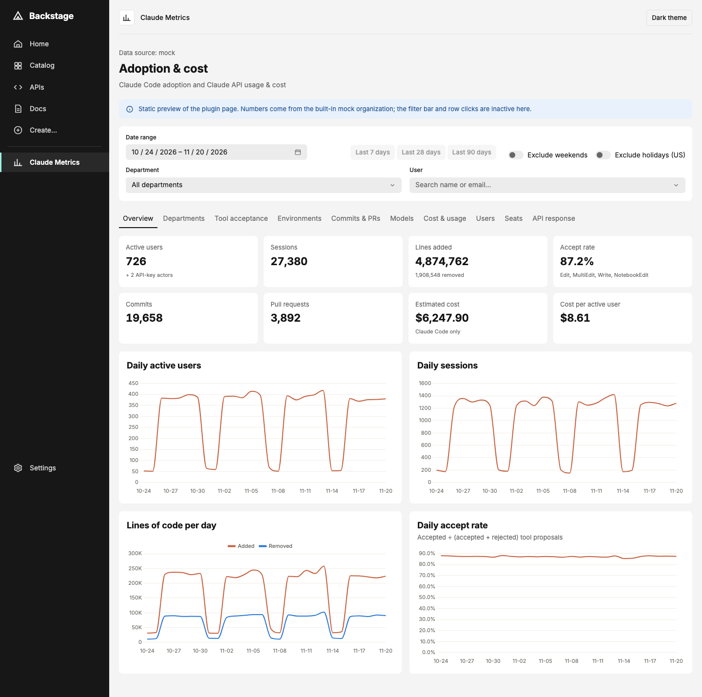

# @moatazeldebsy/backstage-plugin-claude-metrics

Frontend plugin for [Claude Metrics](https://github.com/moatazeldebsy/claude-metrics-viewer): a **Claude Metrics** page in the Backstage sidebar showing your Anthropic organization's Claude Code adoption and Claude API usage and cost. It has ten tabs (overview, departments, tool acceptance, environments, commits and PRs, models, cost, users, seats, raw API response) with date, department and user filters.



Built on Backstage's new frontend system and Backstage UI. It needs the backend plugin, [`@moatazeldebsy/backstage-plugin-claude-metrics-backend`](https://www.npmjs.com/package/@moatazeldebsy/backstage-plugin-claude-metrics-backend).

## Install

```bash
yarn --cwd packages/app add @moatazeldebsy/backstage-plugin-claude-metrics
```

With `app.packages: all`, that's it: the page mounts at `/claude-metrics` and appears in the sidebar. If your app lists features explicitly:

```ts
// packages/app/src/App.tsx
import claudeMetricsPlugin from '@moatazeldebsy/backstage-plugin-claude-metrics';

export default createApp({
  features: [/* ...your plugins */, claudeMetricsPlugin],
});
```

The page checks the `claude-metrics.dashboard.read` permission before loading, so your permission policy decides who sees it.

See the [integration guide](https://github.com/moatazeldebsy/claude-metrics-viewer/blob/main/docs/backstage-integration.md) for configuration, access control and troubleshooting.
