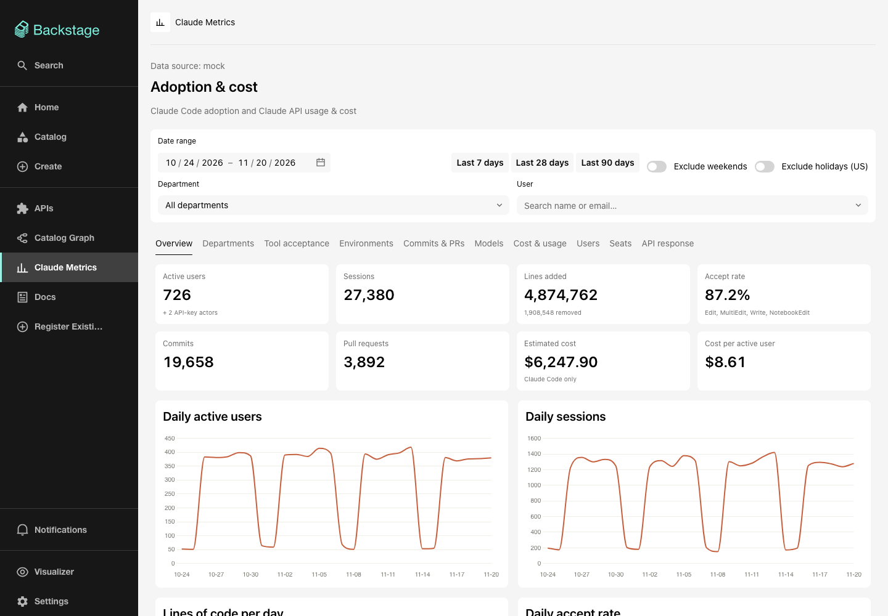

# Adding Claude Metrics to an existing Backstage

This guide is for the team that runs your Backstage. It covers what the plugin needs, how to build and install it into an existing app and backend, how to configure and deploy it, and how to check it works.



## What you get

| Package | Role | Adds |
|---|---|---|
| `@internal/backstage-plugin-claude-metrics` | frontend plugin | A **Claude Metrics** page at `/claude-metrics` with a sidebar entry: 10 tabs covering Claude Code adoption, departments, tool acceptance, environments, commits and PRs, models, org-wide cost, users, idle seats and raw API rows. Filters live in the URL, so views can be shared. |
| `@internal/backstage-plugin-claude-metrics-backend` | backend plugin | `/api/claude-metrics/*`: 8 read-only routes that call the Anthropic Admin API (or a built-in mock org). |
| `@internal/backstage-plugin-claude-metrics-common` | library | The `claude-metrics.dashboard.read` permission. Your permission policy imports it. |
| `@internal/claude-metrics-lib` | library | The data layer both plugins use. It's installed as a dependency; you don't configure it. |

The plugins store nothing: no database tables, no migrations. Data comes from Anthropic on request and is cached in memory.

## Requirements

**Backstage**

- **New frontend system and new backend system.** The plugins were built and tested against Backstage **1.57** (`@backstage/cli` 0.36, `@backstage/frontend-plugin-api` 1.x, `@backstage/backend-plugin-api` 1.12). Apps created with `@backstage/create-app` from 1.57 on use both systems by default.
- **Legacy frontend system isn't supported.** If your app still builds routes in `App.tsx` with `<Route>` elements and `<FlatRoutes>`, the frontend plugin won't mount. The backend plugin works on any new-backend-system backend.
- Older Backstage versions haven't been tested. If you're behind, upgrade first (`yarn backstage-cli versions:bump`) or test in a branch.
- **A sign-in provider.** Every route requires a signed-in user (or a service token), using Backstage's default auth policy. Guest sign-in works for trying it out.
- **The permission framework, to limit who sees it.** The dashboard is guarded by the `claude-metrics.dashboard.read` permission. With `permission.enabled: true` and a policy (see [Access control](#access-control)), only the users you choose get in. With the permission framework off, Backstage allows every permission, so every signed-in user sees the dashboard.

**Toolchain**

- Node.js 24 and Yarn 4, the same as current Backstage apps.

**Anthropic**

- A Claude Console organization and an **Admin API key** (`sk-ant-admin…`, Console → Settings → Admin keys). Workspace API keys are rejected.
- Outbound HTTPS from the Backstage backend to `api.anthropic.com`. The plugin doesn't configure an HTTP proxy.
- Data covers Claude Code used through that Console organization. Usage under Pro, Max, Team or Enterprise subscriptions isn't in this API.

**Optional**

- A departments CSV (`email,department`, exported from your HR system or IdP). The backend must be able to read it from disk. Without it, every user shows as **Unassigned**.

## Before you start

| Check | How |
|---|---|
| App uses the new frontend system | `packages/app/src/App.tsx` calls `createApp` from `@backstage/frontend-defaults` |
| App discovers plugin packages | `app.packages: all` in `app-config.yaml`, or you'll add the plugin to `createApp({ features })` yourself |
| Backend uses the new backend system | `packages/backend/src/index.ts` calls `createBackend()` and `backend.add(...)` |
| Node and Yarn versions | `node -v` is 24.x, `yarn -v` is 4.x |
| Admin key available as a secret | It will be injected as `ANTHROPIC_ADMIN_KEY` |
| Permission framework on, with your own policy | `permission.enabled: true` and a policy module in `packages/backend` (not `…-allow-all-policy`) |
| A group for the people who may see it | For example an `engineering-managers` team, synced into the catalog as `group:default/engineering-managers` |
| Egress to `api.anthropic.com:443` | `curl -sI https://api.anthropic.com` from a backend pod |

## 1. Build the packages

In a checkout of this repository:

```bash
npm install                        # repo root (the standalone app's dependencies)
cd backstage
corepack enable && yarn install
yarn tsc && yarn build             # type declarations, then dist/ for all three packages

mkdir -p dist-packages
yarn workspace @internal/claude-metrics-lib pack --out dist-packages/claude-metrics-lib.tgz
yarn workspace @internal/backstage-plugin-claude-metrics-common pack --out dist-packages/backstage-plugin-claude-metrics-common.tgz
yarn workspace @internal/backstage-plugin-claude-metrics-backend pack --out dist-packages/backstage-plugin-claude-metrics-backend.tgz
yarn workspace @internal/backstage-plugin-claude-metrics pack --out dist-packages/backstage-plugin-claude-metrics.tgz
```

`pack` rewrites each `package.json` to point at `dist/`, so the tarballs work outside this repo.

**Private registry instead of tarballs.** To publish, set `"private": false` in the four `package.json` files, rename the `@internal` scope to one your registry owns (in package names and in the dependencies between them), add `publishConfig.registry`, and run `yarn npm publish` in each package after `yarn build`. Then skip the `resolutions` step below and add the packages by version.

## 2. Install into your app

Copy the four tarballs into your Backstage repository, for example under `vendor/`, and commit them. In the repository's root `package.json`, point the package names at them:

```json
{
  "resolutions": {
    "@internal/claude-metrics-lib": "file:./vendor/claude-metrics-lib.tgz",
    "@internal/backstage-plugin-claude-metrics-common": "file:./vendor/backstage-plugin-claude-metrics-common.tgz",
    "@internal/backstage-plugin-claude-metrics": "file:./vendor/backstage-plugin-claude-metrics.tgz",
    "@internal/backstage-plugin-claude-metrics-backend": "file:./vendor/backstage-plugin-claude-metrics-backend.tgz"
  }
}
```

The lib and common packages need entries too: the plugins depend on them by name, and they aren't on the public registry.

**Frontend.** Add the dependency to `packages/app/package.json`:

```json
"@internal/backstage-plugin-claude-metrics": "^0.1.0"
```

With `app.packages: all`, nothing else is needed: the app picks up the plugin, mounts the page and lists **Claude Metrics** in the sidebar. If your app lists features explicitly instead:

```ts
// packages/app/src/App.tsx
import claudeMetricsPlugin from '@internal/backstage-plugin-claude-metrics';

export default createApp({
  features: [/* ...your plugins */, claudeMetricsPlugin],
});
```

If your sidebar picks items by hand (`nav.take(...)`), the page's nav id is `page:claude-metrics`.

**Backend.** Add the dependency to `packages/backend/package.json`:

```json
"@internal/backstage-plugin-claude-metrics-backend": "^0.1.0"
```

and register it in `packages/backend/src/index.ts`, before `backend.start()`:

```ts
backend.add(import('@internal/backstage-plugin-claude-metrics-backend'));
```

Then run `yarn install` at the repository root.

## 3. Configure

Add to `app-config.yaml`, or to `app-config.production.yaml` for production only:

```yaml
claudeMetrics:
  dataSource: anthropic                     # mock (default) serves a seeded 1,200-person org
  adminKey: ${ANTHROPIC_ADMIN_KEY}
  departmentsFile: /etc/claude-metrics/departments.csv   # optional
  holidayCountry: US                        # optional; country or region, e.g. US-CA, DE, GB
```

- `adminKey` is marked secret in the plugin's config schema, so it's never sent to the browser. Keep it out of the file and inject the env var.
- Keys you leave out fall back to these env vars: `DATA_SOURCE`, `ANTHROPIC_ADMIN_KEY`, `DEPARTMENTS_FILE`, `HOLIDAY_COUNTRY`.
- If the settings select `anthropic` and no key is set anywhere, the backend refuses to start with `claudeMetrics.adminKey is required when dataSource is anthropic`.
- A relative `departmentsFile` resolves against the backend's working directory. Use an absolute path in containers.
- The CSV is read once, on the first request after startup. Restart the backend to pick up a new file.

**Try it on mock data first.** Leave out `dataSource` (or set `mock`) and you get the full UI with no key and no egress.

## 4. Deploy

**Image.** If you build with Backstage's standard backend Dockerfile, the `vendor/` tarballs must be in the image before `yarn install` runs: copy `vendor/` next to `yarn.lock` and `package.json`. With a private registry there's nothing extra.

**Secret and CSV on Kubernetes** (adapt to your chart):

```yaml
# Secret with the Admin key
apiVersion: v1
kind: Secret
metadata: { name: claude-metrics }
stringData:
  ANTHROPIC_ADMIN_KEY: sk-ant-admin-...
---
# Departments CSV
apiVersion: v1
kind: ConfigMap
metadata: { name: claude-metrics-departments }
data:
  departments.csv: |
    email,department
    ada@example.com,Platform
```

```yaml
# In the backend Deployment's pod spec
containers:
  - name: backstage
    envFrom:
      - secretRef: { name: claude-metrics }
    volumeMounts:
      - { name: departments, mountPath: /etc/claude-metrics, readOnly: true }
volumes:
  - name: departments
    configMap: { name: claude-metrics-departments }
```

If you use External Secrets or Vault, map the key to the `ANTHROPIC_ADMIN_KEY` env var the same way.

## 5. Check it works

1. **Backend started.** The backend log shows `Plugin initialization complete` with `claude-metrics` in the list.
2. **Auth is enforced.** `curl -i https://<backstage>/api/claude-metrics/meta` without a token returns `401`.
3. **UI.** Sign in as someone in the allowed group, choose **Claude Metrics** in the sidebar, and check that the header reads `Data source: anthropic` and the Overview tab shows numbers for the last 28 days.
4. **Access control.** Sign in as someone outside the group: the page says *You don't have access to Claude Metrics*, and the API returns `403` for their token.
5. **Departments.** If you supplied a CSV, the Department filter lists your departments and Unassigned is small.

## Running it

- **First loads are slow on large ranges.** Claude Code data comes one day per API call, so a 90-day view makes 90+ calls (5 at a time). Completed days are then cached in memory, and the member list is cached for 10 minutes.
- **Each backend replica has its own cache.** With several replicas, each warms up separately, and a restart clears the cache.
- **Cost data lags** 4 to 24 hours and starts at 2026-01-01. The Cost tab is always organization-wide, because the cost API has no department or user dimension.
- **Upstream errors** (bad key, Anthropic outage) show in the UI as the upstream message with HTTP 503, and are logged by the backend as `claude-metrics upstream error`.

## Access control

The dashboard shows per-user activity and cost for the whole organization, so it's guarded by one permission, `claude-metrics.dashboard.read` (`claudeMetricsReadPermission` in `@internal/backstage-plugin-claude-metrics-common`).

- **Backend:** every `/api/claude-metrics/*` route asks your permission policy and returns `403` on deny, so the data is protected even from clients that skip the UI.
- **Frontend:** the page asks the same question first. Users without it see *You don't have access to Claude Metrics* and nothing is loaded.
- The permission is registered with the permission backend, so it shows up in permission tooling.

Who gets it is decided by **your** permission policy. Backstage runs one policy per app, so the plugin can't install its own: add a clause to yours.


### Managers only

Give the permission to the members of a managers group and deny it to everyone else:

```ts
import { isPermission } from '@backstage/plugin-permission-common';
import { claudeMetricsReadPermission } from '@internal/backstage-plugin-claude-metrics-common';

/** Who may open Claude Metrics. Group refs from the catalog; user refs also work. */
export const CLAUDE_METRICS_GROUPS = ['group:default/engineering-managers'];

// In your PermissionPolicy.handle(request, user), before the final ALLOW:
if (isPermission(request.permission, claudeMetricsReadPermission)) {
  const refs = user?.info?.ownershipEntityRefs ?? [];
  return {
    result: refs.some(ref => CLAUDE_METRICS_GROUPS.includes(ref))
      ? AuthorizeResult.ALLOW
      : AuthorizeResult.DENY,
  };
}
```

Add `@internal/backstage-plugin-claude-metrics-common` to `packages/backend/package.json` for the import.

`ownershipEntityRefs` holds the user's own ref and every group they're a member of in the catalog, so membership comes from wherever your groups come from (GitHub or Microsoft Entra ID org sync, LDAP, or YAML). Guest sign-in has no groups (it signs in as `user:development/guest`), so guests are always denied.

### In the platform template (`backstage-platform-template`)

Its policy, `IdpPermissionPolicy` in `backstage/app/packages/backend/src/modules/idpPermissionPolicy.ts`, already lets `group:default/platform-team` do anything and lets other signed-in users do almost everything. Add the clause **after** the platform-admin check and **before** the final `return { result: AuthorizeResult.ALLOW }`:

```ts
if (isPlatformAdmin(user)) {
  return { result: AuthorizeResult.ALLOW };   // platform-team keeps access
}
if (isPermission(request.permission, claudeMetricsReadPermission)) {
  const refs = user?.info?.ownershipEntityRefs ?? [];
  return {
    result: refs.some(ref => CLAUDE_METRICS_GROUPS.includes(ref))
      ? AuthorizeResult.ALLOW
      : AuthorizeResult.DENY,
  };
}
```

The template's groups are synced from GitHub teams (`catalog.providers.githubOrg`, ADR-0004). Create an `engineering-managers` team in the identity org. Within the 30-minute sync it appears as `group:default/engineering-managers`, and its members get access. The template's `app.packages` isn't `all`: add `claudeMetricsPlugin` to `createApp({ features })` in `packages/app/src/App.tsx`. The template is on Backstage 1.56.2; the plugins were tested on 1.57, so try them in a branch first.

This clause was tested in a fresh Backstage 1.57 app with the packed tarballs. A user outside the group got the no-access page and `403` from the API with the same token that read the catalog; a user in the allow-list got the dashboard and `200`.

## Troubleshooting

| Symptom | Cause and fix |
|---|---|
| Backend exits with `claudeMetrics.adminKey is required…` | `dataSource: anthropic` with no key. Check that the secret reaches the pod as `ANTHROPIC_ADMIN_KEY`. |
| `yarn install` can't find `@internal/claude-metrics-lib` | Missing `resolutions` entry for the lib tarball, or `vendor/` isn't in the Docker build context. |
| No **Claude Metrics** in the sidebar | The app doesn't discover packages (`app.packages`), or your sidebar picks items by id. Add the plugin to `features`, or `nav.take('page:claude-metrics')`. |
| A manager sees *You don't have access* | They aren't in the group yet (org sync can take up to its schedule, e.g. 30 minutes), or the policy clause comes after an earlier `return` that already decided. Check the user's groups on their catalog page. |
| Everyone can open the page | `permission.enabled` is `false`, or the app still uses the allow-all policy module. |
| Page shows "Could not load data … 401" | The browser session expired, or a proxy in front of Backstage strips the `Authorization` header. |
| Every tab shows a 503 with an Anthropic error | Wrong key type (workspace key instead of Admin key), revoked key, or no egress to `api.anthropic.com`. |
| Everyone is **Unassigned** | No `departmentsFile`, a wrong path, or emails in the CSV don't match Console member emails (matching ignores case). |
| Frontend error about routes or extensions on startup | The app uses the legacy frontend system. See Requirements. |

## Updating and removing

- **Update:** rebuild the four tarballs (or publish new versions), replace them in `vendor/`, run `yarn install`, and redeploy. There's nothing to migrate.
- **Remove:** delete the two plugin dependencies, the `backend.add(...)` line, the policy clause, the `resolutions` entries and the `claudeMetrics` config block. Nothing is left behind.
