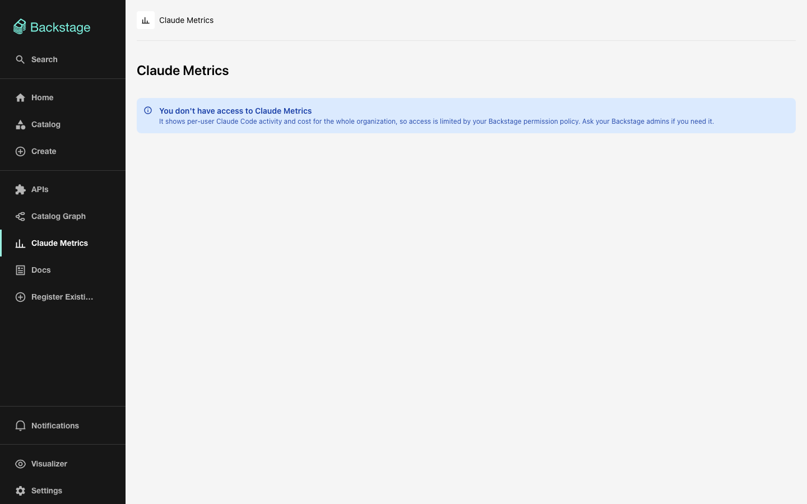

# Adding Claude Metrics to an existing Backstage

This guide is for the team that runs your Backstage. It covers what the plugin needs, how to build and install it into an existing app and backend, how to configure and deploy it, and how to check it works.


## What you get

| Package | Role | Adds |
|---|---|---|
| `@moatazeldebsy/backstage-plugin-claude-metrics` | frontend plugin | A **Claude Metrics** page at `/claude-metrics` with a sidebar entry: 10 tabs covering Claude Code adoption, departments, tool acceptance, environments, commits and PRs, models, org-wide cost, users, idle seats and raw API rows. Filters live in the URL, so views can be shared. |
| `@moatazeldebsy/backstage-plugin-claude-metrics-backend` | backend plugin | `/api/claude-metrics/*`: 8 read-only routes that call the Anthropic Admin API (or a built-in mock org). |
| `@moatazeldebsy/backstage-plugin-claude-metrics-common` | library | The `claude-metrics.dashboard.read` permission. Your permission policy imports it. |
| `@moatazeldebsy/claude-metrics-lib` | library | The data layer both plugins use. It's installed as a dependency; you don't configure it. |

The plugins store nothing: no database tables, no migrations. Data comes from Anthropic on request and is cached in memory.

## Requirements

**Backstage**

- **Backstage 1.56.2 or newer, on the new frontend system and new backend system.** The plugins are built against the 1.56.2 release (`@backstage/frontend-plugin-api` 0.18, `@backstage/ui` 0.19, `@backstage/backend-plugin-api` 1.11) and tested in a 1.56.2 app and a 1.57 app. Newer apps accept plugins built for older releases, but not the other way round, so building against 1.57 would break 1.56 apps (`createApp` rejects the plugin: *Property 'id' is missing*). On 1.57 and later, yarn installs the plugin's own copies of `frontend-plugin-api` 0.18 and `ui` 0.19 next to the app's; that's expected.
- **Legacy frontend system isn't supported.** If your app still builds routes in `App.tsx` with `<Route>` elements and `<FlatRoutes>`, the frontend plugin won't mount. The backend plugin works on any new-backend-system backend.
- Older Backstage versions haven't been tested. If you're behind, upgrade first (`yarn backstage-cli versions:bump`) or test in a branch.
- **A sign-in provider.** Every route requires a signed-in user (or a service token), using Backstage's default auth policy. Guest sign-in works for trying it out.
- **The permission framework, to limit who sees it.** The dashboard is guarded by the `claude-metrics.dashboard.read` permission. With `permission.enabled: true` and a policy (see [Access control](#access-control)), only the users you choose get in. With the permission framework off, Backstage allows every permission, so every signed-in user sees the dashboard.

**Toolchain**

- Node.js 22 or 24 and Yarn 4. The platform template's image runs the plugins on Node 22.

**Which data source**

Pick one per Backstage deployment. What decides it is how Claude Code is paid for; the README's [Which setup is for me](../README.md#which-setup-is-for-me) has the full table.

| You are | `claudeMetrics.dataSource` | You need |
|---|---|---|
| A team on Team or Enterprise seats, or one person on Pro/Max | `otel` | `claudeMetrics.otel.ingestTokens`, and Claude Code's env vars rolled out through managed settings. See [OpenTelemetry instead of the Admin API](#opentelemetry-instead-of-the-admin-api) |
| An organization using Claude Code with Console API keys | `anthropic` | An Admin API key (below) |
| A mix of both | `otel` | As above. Only OpenTelemetry sees subscription usage |
| Trying it out | `mock` (default) | Nothing |

**Anthropic Admin API (`dataSource: anthropic`)**

- A Claude Console organization and an **Admin API key** (`sk-ant-admin…`, Console → Settings → Admin keys). Workspace API keys are rejected.
- Outbound HTTPS from the Backstage backend to `api.anthropic.com`. The plugin doesn't configure an HTTP proxy.
- Data covers Claude Code used through that Console organization. Usage under Pro, Max, Team or Enterprise subscriptions isn't in this API.
- **No Admin key?** Use the OpenTelemetry source instead: Claude Code sends its metrics to Backstage, and you need neither a key nor egress. See [OpenTelemetry instead of the Admin API](#opentelemetry-instead-of-the-admin-api).

**Optional**

- A departments CSV (`email,department`, exported from your HR system or IdP). The backend must be able to read it from disk. Without it, every user shows as **Unassigned**.

## Before you start

| Check | How |
|---|---|
| App uses the new frontend system | `packages/app/src/App.tsx` calls `createApp` from `@backstage/frontend-defaults` |
| App discovers plugin packages | `app.packages: all` in `app-config.yaml`, or you'll add the plugin to `createApp({ features })` yourself |
| Backend uses the new backend system | `packages/backend/src/index.ts` calls `createBackend()` and `backend.add(...)` |
| Node and Yarn versions | `node -v` is 24.x, `yarn -v` is 4.x |
| Admin key available as a secret | It will be injected as `ANTHROPIC_ADMIN_KEY` |
| Permission framework on, with your own policy | `permission.enabled: true` and a policy module in `packages/backend` (not `…-allow-all-policy`) |
| A group for the people who may see it | For example an `engineering-managers` team, synced into the catalog as `group:default/engineering-managers` |
| Egress to `api.anthropic.com:443` | `curl -sI https://api.anthropic.com` from a backend pod |

## 1. Get the packages

The packages are on npm under `@moatazeldebsy`:

| Package | |
|---|---|
| [`@moatazeldebsy/backstage-plugin-claude-metrics`](https://www.npmjs.com/package/@moatazeldebsy/backstage-plugin-claude-metrics) | Frontend plugin |
| [`@moatazeldebsy/backstage-plugin-claude-metrics-backend`](https://www.npmjs.com/package/@moatazeldebsy/backstage-plugin-claude-metrics-backend) | Backend plugin |
| [`@moatazeldebsy/backstage-plugin-claude-metrics-common`](https://www.npmjs.com/package/@moatazeldebsy/backstage-plugin-claude-metrics-common) | Permission, shared by both |
| [`@moatazeldebsy/claude-metrics-lib`](https://www.npmjs.com/package/@moatazeldebsy/claude-metrics-lib) | Data layer, shared by both |

You only add the frontend and backend plugins; the other two come in as their dependencies. Go to step 2.

**Offline or air-gapped: build tarballs instead.** In a checkout of this repository:

```bash
npm install                        # repo root (the standalone app's dependencies)
cd backstage
corepack enable && yarn install
yarn tsc && yarn build             # type declarations, then dist/ for all four packages

mkdir -p dist-packages
yarn workspace @moatazeldebsy/claude-metrics-lib pack --out dist-packages/claude-metrics-lib.tgz
yarn workspace @moatazeldebsy/backstage-plugin-claude-metrics-common pack --out dist-packages/backstage-plugin-claude-metrics-common.tgz
yarn workspace @moatazeldebsy/backstage-plugin-claude-metrics-backend pack --out dist-packages/backstage-plugin-claude-metrics-backend.tgz
yarn workspace @moatazeldebsy/backstage-plugin-claude-metrics pack --out dist-packages/backstage-plugin-claude-metrics.tgz
```

`pack` rewrites each `package.json` to point at `dist/`, so the tarballs work outside this repo. Copy them into your Backstage repository, for example under `vendor/`, commit them, and point the package names at them in the repository's root `package.json`:

```json
{
  "resolutions": {
    "@moatazeldebsy/claude-metrics-lib": "file:./vendor/claude-metrics-lib.tgz",
    "@moatazeldebsy/backstage-plugin-claude-metrics-common": "file:./vendor/backstage-plugin-claude-metrics-common.tgz",
    "@moatazeldebsy/backstage-plugin-claude-metrics": "file:./vendor/backstage-plugin-claude-metrics.tgz",
    "@moatazeldebsy/backstage-plugin-claude-metrics-backend": "file:./vendor/backstage-plugin-claude-metrics-backend.tgz"
  }
}
```

All four need entries, so the lib and common packages also resolve to your tarballs rather than npm.

## 2. Install into your app

**Frontend.** Add the dependency to `packages/app/package.json`:

```json
"@moatazeldebsy/backstage-plugin-claude-metrics": "^0.1.0"
```

With `app.packages: all`, nothing else is needed: the app picks up the plugin, mounts the page and lists **Claude Metrics** in the sidebar. If your app lists features explicitly instead:

```ts
// packages/app/src/App.tsx
import claudeMetricsPlugin from '@moatazeldebsy/backstage-plugin-claude-metrics';

export default createApp({
  features: [/* ...your plugins */, claudeMetricsPlugin],
});
```

If your sidebar picks items by hand (`nav.take(...)`), the page's nav id is `page:claude-metrics`.

**Backend.** Add the dependency to `packages/backend/package.json`:

```json
"@moatazeldebsy/backstage-plugin-claude-metrics-backend": "^0.1.0"
```

and register it in `packages/backend/src/index.ts`, before `backend.start()`:

```ts
backend.add(import('@moatazeldebsy/backstage-plugin-claude-metrics-backend'));
```

Then run `yarn install` at the repository root.

## 3. Configure

Add to `app-config.yaml`, or to `app-config.production.yaml` for production only:

```yaml
claudeMetrics:
  dataSource: anthropic                     # mock (default) serves a seeded 1,200-person org
  adminKey: ${ANTHROPIC_ADMIN_KEY}
  departmentsFile: /etc/claude-metrics/departments.csv   # optional
  holidayCountry: US                        # optional; country or region, e.g. US-CA, DE, GB
```

- `adminKey` is marked secret in the plugin's config schema, so it's never sent to the browser. Keep it out of the file and inject the env var.
- Keys you leave out fall back to these env vars: `DATA_SOURCE`, `ANTHROPIC_ADMIN_KEY`, `DEPARTMENTS_FILE`, `HOLIDAY_COUNTRY`.
- If the settings select `anthropic` and no key is set anywhere, the plugin fails at startup with `claudeMetrics.adminKey is required when dataSource is anthropic`. Backstage logs it as *Backend startup failed*. In the versions tested (1.56, 1.57) the rest of Backstage keeps serving and only `/api/claude-metrics/*` returns `503`, so check the backend log, not just the health check.
- A relative `departmentsFile` resolves against the backend's working directory. Use an absolute path in containers.
- The CSV is read once, on the first request after startup. Restart the backend to pick up a new file.

**Try it on mock data first.** Leave out `dataSource` (or set `mock`) and you get the full UI with no key and no egress.

### The Anthropic Admin API key

Real data needs an **Admin API key** from the Claude Console organization you want to report on.

**Which key.** Create it in the Claude Console under **Settings → Admin keys**; only organization admins can. Admin keys start with `sk-ant-admin`. A regular API key (`sk-ant-api…`, the `ANTHROPIC_API_KEY` that SDKs and AI tools use) doesn't work: the Admin API rejects it, and every tab shows a 503 with Anthropic's error.

**Treat it as a high-privilege credential.** An Admin key can manage the whole organization (members, workspaces, API keys). The plugin only calls read endpoints: the Claude Code usage report, the cost report and the member list. Create a dedicated key (for example named `backstage-claude-metrics`) so you can revoke it without affecting anything else, keep it in your secret store, and limit who can read that secret.

**How Backstage receives it.** One environment variable, `ANTHROPIC_ADMIN_KEY`, on the **backend** process, referenced from config:

```yaml
claudeMetrics:
  dataSource: anthropic
  adminKey: ${ANTHROPIC_ADMIN_KEY}
```

- If the variable isn't set, or is set but empty (Docker Compose's `${VAR:-}` passes an empty string), `adminKey` counts as missing; config still loads. On `mock` that's fine. On `anthropic` the plugin fails at startup with `claudeMetrics.adminKey is required when dataSource is anthropic`, logged as *Backend startup failed*, and its routes return `503` while the rest of Backstage keeps running.
- The value never reaches the browser: `adminKey` is a secret in the plugin's config schema, and the frontend config contains no `claudeMetrics` block at all.
- The key is read once, when the first request needs data. **Restart the backend after rotating it.**
- Don't write the literal key into a committed `app-config*.yaml`.

**Setting the variable, per environment:**

*Local development (`yarn start`).* `backstage-cli` doesn't read `.env` files, so export the variable in the shell that starts Backstage (or use `direnv`):

```bash
export ANTHROPIC_ADMIN_KEY=sk-ant-admin-...
yarn start
```

Alternatively, put `claudeMetrics.adminKey` in `app-config.local.yaml`; apps created with `@backstage/create-app` git-ignore `*.local.yaml`. Check yours does before relying on it.

*Docker.* Pass it at run time, never as a build argument or `ENV` line, which would bake it into the image:

```bash
docker run -e ANTHROPIC_ADMIN_KEY ... your-backstage-image     # from your shell
docker run --env-file backstage.env ... your-backstage-image   # or from a git-ignored file
```

*Docker Compose.* Variables reach the container only when they're listed on the service. Compose fills `${...}` from the `.env` file next to the compose file:

```yaml
services:
  backstage:
    environment:
      ANTHROPIC_ADMIN_KEY: ${ANTHROPIC_ADMIN_KEY:-}
```

*Kubernetes manifests.* Store it in a Secret and load it into the backend container:

```yaml
apiVersion: v1
kind: Secret
metadata: { name: claude-metrics }
type: Opaque
stringData:
  ANTHROPIC_ADMIN_KEY: sk-ant-admin-...   # or create it with kubectl, not in git
---
# In the backend Deployment's container spec:
envFrom:
  - secretRef: { name: claude-metrics }
```

To create the Secret without writing the key to a file: `kubectl create secret generic claude-metrics -n backstage --from-literal=ANTHROPIC_ADMIN_KEY=sk-ant-admin-...`

*Backstage Helm chart* (`backstage/charts`). List the Secret under `extraEnvVarsSecrets`; every key in it becomes an env var:

```yaml
backstage:
  extraEnvVarsSecrets:
    - claude-metrics
```

or pick the one key with `extraEnvVars`:

```yaml
backstage:
  extraEnvVars:
    - name: ANTHROPIC_ADMIN_KEY
      valueFrom:
        secretKeyRef: { name: claude-metrics, key: ANTHROPIC_ADMIN_KEY }
```

Don't put the key in the chart's `backstage.appConfig`: it's rendered into a ConfigMap, and the chart warns against secrets there.

*External Secrets Operator* (AWS Secrets Manager, Vault, GCP Secret Manager, Azure Key Vault). Sync the key into the same Kubernetes Secret, then load it as above:

```yaml
apiVersion: external-secrets.io/v1
kind: ExternalSecret
metadata: { name: claude-metrics, namespace: backstage }
spec:
  refreshInterval: 1h
  secretStoreRef: { name: your-secret-store, kind: SecretStore }
  target: { name: claude-metrics }
  data:
    - secretKey: ANTHROPIC_ADMIN_KEY
      remoteRef: { key: backstage/claude-metrics, property: ANTHROPIC_ADMIN_KEY }
```

If ESO already fills a shared Secret from one entry (`dataFrom: extract`), add `ANTHROPIC_ADMIN_KEY` to that entry instead. The pod sees it without a manifest change only if it loads that Secret with `envFrom`. If the Deployment lists variables one by one (`env:` with `secretKeyRef`), add an entry for `ANTHROPIC_ADMIN_KEY` there too, with `optional: true`.

**Check it arrived** without printing it:

```bash
kubectl exec -n backstage deploy/backstage -- sh -c 'test -n "$ANTHROPIC_ADMIN_KEY" && echo set || echo missing'
```

Then open Claude Metrics: the header says `Data source: anthropic` and the Overview tab shows your organization's numbers. A 503 on every tab with an authentication error means the key is wrong, revoked, or a regular API key.

**Rotate it** by creating a new Admin key, updating the secret, restarting the backend (`kubectl rollout restart deploy/backstage -n backstage`), checking the page loads, and then revoking the old key in the Console.

### OpenTelemetry instead of the Admin API

With `dataSource: otel` the backend receives Claude Code's OpenTelemetry metrics and stores daily totals in the plugin's own database (SQLite in development, your Postgres in production; the plugin runs its migrations at startup). This covers subscription usage (Pro, Max, Team, Enterprise) and needs no Admin key. Cost & usage and Seats aren't available, and the API response tab is hidden; see [docs/opentelemetry.md](opentelemetry.md) for the full picture.

```yaml
claudeMetrics:
  dataSource: otel
  otel:
    ingestTokens:
      - ${CLAUDE_METRICS_INGEST_TOKEN}   # secret; add a second entry while rotating
    retentionDays: 400                   # optional; 0 keeps everything
  departmentsFile: /etc/claude-metrics/departments.csv   # optional; brings back Seats and adoption
```

- **Ingest URL:** `<backend base URL>/api/claude-metrics/otlp`. That's the value for Claude Code's `OTEL_EXPORTER_OTLP_ENDPOINT`; Claude Code appends `/v1/metrics`. The page shows the exact settings, with your URL, until the first data arrives.
- **Auth:** this is the plugin's only route that doesn't need a signed-in Backstage user, because Claude Code can't get a Backstage token. The plugin registers it as `allow: 'unauthenticated'` and checks the bearer token against `otel.ingestTokens` instead. Without a token configured it answers `503` and stores nothing. It only accepts writes and returns no data; every dashboard route still needs `claude-metrics.dashboard.read`.
- **Reachability:** Claude Code on developers' machines must reach that URL. If your Backstage sits behind SSO at an ingress or proxy, add an exception for `/api/claude-metrics/otlp` only.
- **Request size:** up to 5 MB per export, gzip allowed. Claude Code's exports are a few kilobytes.
- **Retention** runs once a day through the Backstage scheduler, so with several replicas only one prunes.

Check it with the fixture from this repo (expect `200`):

```bash
curl -i -X POST https://<backstage>/api/claude-metrics/otlp/v1/metrics \
  -H 'content-type: application/x-protobuf' \
  -H "authorization: Bearer $CLAUDE_METRICS_INGEST_TOKEN" \
  --data-binary @tests/fixtures/otlp/claude-code-metrics.pb
```

## 4. Deploy

**Image.** Installed from npm, there's nothing extra. With the tarball route and Backstage's standard backend Dockerfile, the `vendor/` tarballs must be in the image before `yarn install` runs: copy `vendor/` next to `yarn.lock` and `package.json`.

**Admin key.** See [The Anthropic Admin API key](#the-anthropic-admin-api-key) for Docker, Compose, Kubernetes, the Helm chart and External Secrets.

**Departments CSV on Kubernetes** (adapt to your chart):

```yaml
apiVersion: v1
kind: ConfigMap
metadata: { name: claude-metrics-departments }
data:
  departments.csv: |
    email,department
    ada@example.com,Platform
```

```yaml
# In the backend Deployment's pod spec
containers:
  - name: backstage
    volumeMounts:
      - { name: departments, mountPath: /etc/claude-metrics, readOnly: true }
volumes:
  - name: departments
    configMap: { name: claude-metrics-departments }
```


## 5. Check it works

1. **Backend started.** The backend log shows `Plugin initialization complete` with `claude-metrics` in the list.
2. **Auth is enforced.** `curl -i https://<backstage>/api/claude-metrics/meta` without a token returns `401`.
3. **UI.** Sign in as someone in the allowed group, choose **Claude Metrics** in the sidebar, and check that the header reads `Data source: anthropic` and the Overview tab shows numbers for the last 28 days.
4. **Access control.** Sign in as someone outside the group: the page says *You don't have access to Claude Metrics*, and the API returns `403` for their token.
5. **Departments.** If you supplied a CSV, the Department filter lists your departments and Unassigned is small.

## Running it

- **First loads are slow on large ranges.** Claude Code data comes one day per API call, so a 90-day view makes 90+ calls (5 at a time). Completed days are then cached in memory, and the member list is cached for 10 minutes.
- **Each backend replica has its own cache.** With several replicas, each warms up separately, and a restart clears the cache.
- **Cost data lags** 4 to 24 hours and starts at 2026-01-01. The Cost tab is always organization-wide, because the cost API has no department or user dimension.
- **Upstream errors** (bad key, Anthropic outage) show in the UI as the upstream message with HTTP 503, and are logged by the backend as `claude-metrics upstream error`.

## Access control

The dashboard shows per-user activity and cost for the whole organization, so it's guarded by one permission, `claude-metrics.dashboard.read` (`claudeMetricsReadPermission` in `@moatazeldebsy/backstage-plugin-claude-metrics-common`).

- **Backend:** every `/api/claude-metrics/*` route asks your permission policy and returns `403` on deny, so the data is protected even from clients that skip the UI.
- **Frontend:** the page asks the same question first. Users without it see *You don't have access to Claude Metrics* and nothing is loaded.
- The permission is registered with the permission backend, so it shows up in permission tooling.

Who gets it is decided by **your** permission policy. Backstage runs one policy per app, so the plugin can't install its own: add a clause to yours.



### Managers only

Give the permission to the members of a managers group and deny it to everyone else:

```ts
import { isPermission } from '@backstage/plugin-permission-common';
import { claudeMetricsReadPermission } from '@moatazeldebsy/backstage-plugin-claude-metrics-common';

/** Who may open Claude Metrics. Group refs from the catalog; user refs also work. */
export const CLAUDE_METRICS_GROUPS = ['group:default/engineering-managers'];

// In your PermissionPolicy.handle(request, user), before the final ALLOW:
if (isPermission(request.permission, claudeMetricsReadPermission)) {
  const refs = user?.info?.ownershipEntityRefs ?? [];
  return {
    result: refs.some(ref => CLAUDE_METRICS_GROUPS.includes(ref))
      ? AuthorizeResult.ALLOW
      : AuthorizeResult.DENY,
  };
}
```

Add `@moatazeldebsy/backstage-plugin-claude-metrics-common` to `packages/backend/package.json` for the import.

`ownershipEntityRefs` holds the user's own ref and every group they're a member of in the catalog, so membership comes from wherever your groups come from (GitHub or Microsoft Entra ID org sync, LDAP, or YAML). Guest sign-in has no groups (it signs in as `user:development/guest`), so guests are always denied.

### In the platform template (`backstage-platform-template`)

Its policy, `IdpPermissionPolicy` in `backstage/app/packages/backend/src/modules/idpPermissionPolicy.ts`, already lets `group:default/platform-team` do anything and lets other signed-in users do almost everything. Add the clause **after** the platform-admin check and **before** the final `return { result: AuthorizeResult.ALLOW }`:

```ts
if (isPlatformAdmin(user)) {
  return { result: AuthorizeResult.ALLOW };   // platform-team keeps access
}
if (isPermission(request.permission, claudeMetricsReadPermission)) {
  const refs = user?.info?.ownershipEntityRefs ?? [];
  return {
    result: refs.some(ref => CLAUDE_METRICS_GROUPS.includes(ref))
      ? AuthorizeResult.ALLOW
      : AuthorizeResult.DENY,
  };
}
```

For the Admin key, follow the template's existing pattern for optional API keys:

- **Local:** add `ANTHROPIC_ADMIN_KEY=` to `local/backstage/.env.example` and your `local/backstage/.env`, list `ANTHROPIC_ADMIN_KEY: ${ANTHROPIC_ADMIN_KEY:-}` under the `backstage` service's `environment:` in `local/backstage/docker-compose.yml`, and set `dataSource: anthropic` in `backstage/app-config.local.yaml` when you want real data.
- **AWS:** add `ANTHROPIC_ADMIN_KEY` to the optional-keys list in `scripts/bootstrap.sh` (next to `VOYAGE_API_KEY`), or add it by hand to the `idp-mvp/backstage` Secrets Manager entry. The `backstage-secrets` ExternalSecret syncs every key into the cluster, but `aws/backstage/deployment.yaml` maps variables one by one, so add an `ANTHROPIC_ADMIN_KEY` entry with `secretKeyRef` (`optional: true`) next to `VOYAGE_API_KEY`. Set `claudeMetrics.dataSource: anthropic` in `app-config.aws.yaml`; `scripts/lib.sh` turns it into the pod's ConfigMap at deploy time.
- The key in `local/.env.example` called `ANTHROPIC_API_KEY` is the AI stack's regular key. It isn't an Admin key and won't work here.

The template's groups are synced from GitHub teams (`catalog.providers.githubOrg`, ADR-0004). Create an `engineering-managers` team in the identity org. Within the 30-minute sync it appears as `group:default/engineering-managers`, and its members get access. The template's `app.packages` isn't `all`: add `claudeMetricsPlugin` to `createApp({ features })` in `packages/app/src/App.tsx`. The template is on Backstage 1.56.2, the release the plugins are built against.

This clause was tested in a fresh Backstage 1.57 app with the packed tarballs, and with unit tests in the template's own policy test suite. A user outside the group got the no-access page and `403` from the API with the same token that read the catalog; a user in the allow-list got the dashboard and `200`.

## Troubleshooting

| Symptom | Cause and fix |
|---|---|
| Backend exits with `claudeMetrics.adminKey is required…` | `dataSource: anthropic` with no key. Check that the secret reaches the pod as `ANTHROPIC_ADMIN_KEY`. |
| `yarn install` can't find `@moatazeldebsy/claude-metrics-lib` | Tarball route only: missing `resolutions` entry for the lib tarball, or `vendor/` isn't in the Docker build context. |
| No **Claude Metrics** in the sidebar | The app doesn't discover packages (`app.packages`), or your sidebar picks items by id. Add the plugin to `features`, or `nav.take('page:claude-metrics')`. |
| A manager sees *You don't have access* | They aren't in the group yet (org sync can take up to its schedule, e.g. 30 minutes), or the policy clause comes after an earlier `return` that already decided. Check the user's groups on their catalog page. |
| Everyone can open the page | `permission.enabled` is `false`, or the app still uses the allow-all policy module. |
| Page shows "Could not load data … 401" | The browser session expired, or a proxy in front of Backstage strips the `Authorization` header. |
| Header says `Data source: mock` although you set a key | `dataSource` isn't `anthropic` in the config layer that's loaded, so the key is ignored. |
| Every tab shows a 503 with an Anthropic error | Wrong key type (workspace key instead of Admin key), revoked key, or no egress to `api.anthropic.com`. |
| Everyone is **Unassigned** | No `departmentsFile`, a wrong path, or emails in the CSV don't match Console member emails (matching ignores case). |
| Frontend error about routes or extensions on startup | The app uses the legacy frontend system. See Requirements. |
| `dataSource: otel` and the page keeps showing *Waiting for the first data* | Claude Code isn't reaching `/api/claude-metrics/otlp`: check the endpoint, the token, and any SSO proxy in front of Backstage. [OpenTelemetry troubleshooting](opentelemetry.md#troubleshooting) has the details. |
| Claude Code's debug log shows `401` from the ingest URL | The token isn't in `claudeMetrics.otel.ingestTokens`, or a proxy in front of Backstage requires its own login. |

## Updating and removing

- **Update:** bump the two plugin versions in `packages/app` and `packages/backend` (tarball route: rebuild the four tarballs and replace them in `vendor/`), run `yarn install`, and redeploy. There's nothing to migrate.
- **Remove:** delete the two plugin dependencies, the `backend.add(...)` line, the policy clause, the `resolutions` entries and the `claudeMetrics` config block. Nothing is left behind.
